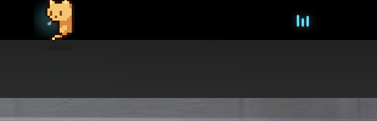

# Atoll

[](https://github.com/AkshayTati/Atoll/actions/workflows/build.yml)

A tiny, personal macOS notch companion: media, calendar, audio, a neon HUD, and
a pixel cat that peeks over the notch.

Atoll lives around the MacBook notch. Hover or click to expand it; when
collapsed it shows the active media player (or a calm calendar peek), while a
small cat keeps you company on the edges.

An atoll is a small island. This one lives at the top of your screen.



## Features

- **Notch shell** — a non-activating panel that starts at the hardware notch,
  grows on hover/click, and animates between collapsed and expanded states.
- **Media** — current track, artwork, accent color, progress, and controls.
  Multiple Now Playing clients are listed through a small helper; the active
  player gets transport controls.
- **Calendar** — a compact date wheel, agenda, and event detail view powered by
  EventKit. Choose which calendars or accounts contribute events in Settings.
  No Google/Outlook OAuth.
- **Audio** — system output switching, volume, and mute controls.
- **Neon HUD** — a compact segmented volume / brightness / mute readout with
  percentage, icon, and neon glow, driven by a global media-key tap.
- **Cat** — a CC0 pixel cat walks, sneaks, runs, grooms, stretches, yawns,
  sleeps, plays, chases a butterfly, and peeks around the left/right edges of
  the notch. Hover to say hi; click to open the island or pet her. A global
  shortcut (default **⌃⌥C**) toggles her from anywhere.
- **Settings** — a separate System Settings-style window opened from the Atoll
  menu: startup, island content, media, calendar accounts/calendars, HUD,
  cat behavior, global shortcuts, and reset.
- **Native macOS** — AppKit + SwiftUI, no sandbox, no Apple Developer account,
  no notarization.

## Requirements

- macOS 14+
- Swift 5.9+ / Command Line Tools
- [`media-control`](https://github.com/ungive/media-control) for multi-client
  media access:
  ```sh
  brew tap ungive/media-control
  brew install media-control
  ```

## Build & install

```sh
git clone https://github.com/AkshayTati/Atoll.git
cd Atoll
./scripts/install.sh
```

`install.sh` builds `Atoll.app`, signs it with the stable self-signed identity
when available, installs it to `~/Applications/Atoll.app`, and launches it.

For development:

```sh
make run     # build, stream logs, and launch build/Atoll.app
make stop    # stop the app and the log stream
```

Optional stable self-signed signing identity:

```sh
make signing
```

## Permissions

- **Calendars** — read-only access for the agenda.
- **Accessibility / Input Monitoring** — global media keys and the
  volume/brightness HUD. Open **Atoll → Enable HUD Control…** to grant it.
- **Apple Events** — optional fallback for media players when the system media
  API is unavailable.

Atoll never captures audio and never uploads your data.

## Settings

Open **Atoll → Settings…** from the menu bar. The settings window is a normal
macOS window, separate from the notch island, and applies changes live.

- **General** — Launch at Login, intro expansion, hover expansion, default module
- **Island** — collapsed media wings and calendar peek
- **Media** — show all Now Playing clients
- **Calendar** — choose all calendars or selected calendars, grouped by account;
  all-day event visibility
- **HUD** — enable/disable, per-control visibility, display duration, Accessibility
  (volume and brightness use the native 1/16 steps, with 1/64 fine steps on Option)
- **Cat** — visibility, pace, sleep timing, peek/greet behavior
- **Shortcuts** — global cat toggle shortcut (default ⌃⌥C), rebindable
- **About** — version, repo, credits, reset

## Cat

The cat is the orange `catset` character. The frames are cropped and aligned to
48×48 for the notch; animations include idle, walk, sneak, run, pounce, sit,
sleep, groom, stretch, yawn, love, greet, surprised, play, butterfly chase, loaf,
wake, jump, land, and a wall-grab peek.

Sprite source: **catset** by **seethingswarm** (CC0), via
[Gheop/CATAI-Linux](https://github.com/Gheop/CATAI-Linux). See
`Resources/CatSprites/README.md`.

## Known limitations

- MediaRemote is a private framework. A macOS update can break multi-client
  media discovery.
- All Now Playing clients are listed, but macOS only routes transport commands
  to the active player. The other rows are read-only.
- The HUD uses private `DisplayServices` for brightness and a `CGEventTap` for
  media keys.
- Audio switching is system-wide; per-app routing is not implemented.
- The cat is decorative. Her animations are synthetic and not audio-reactive.

## Layout

```text
Sources/Atoll/              app (AppKit shell + SwiftUI content)
Sources/Atoll/Settings*     separate settings window and controls
Sources/Atoll/GlobalHotKey  Carbon global shortcut support
Sources/MediaRemoteHelper/  ObjC dylib loaded through Perl for multi-client media
Sources/MediaRemoteShim/    C shim around the private MediaRemote API
Sources/mediaspike/         small CLI probe for MediaRemote
Resources/Info.plist        bundle metadata, usage strings, LSUIElement
Resources/CatSprites/       48×48 cat animations and attribution
scripts/bundle.sh           build + .app assembly + codesign
scripts/build-helper.sh     compile the MediaRemote helper dylib
scripts/install.sh          build, install to ~/Applications, launch
docs/atoll-peek.png         screenshot
```

## Notes

- The panel is an `NSPanel` at `statusBar + 1`, non-activating, joined to all
  spaces, and positioned from `NSScreen.safeAreaInsets` and the auxiliary
  top-left/top-right areas.
- The collapsed shape sits 1pt inside the notch so antialiasing cannot bleed
  onto the menu bar.
- Media discovery uses the private `MediaRemote.framework` through a Perl-hosted
  helper. Fallbacks: MediaRemoteAdapter, ScriptingBridge, per-app AppleScript.
- The cat routes around the physical notch cutout instead of being drawn
  through it.

## Credits

- Cat sprites: [catset](https://seethingswarm.itch.io/catset) by
  **seethingswarm** (CC0), via
  [Gheop/CATAI-Linux](https://github.com/Gheop/CATAI-Linux).
- MediaRemote helper approach is inspired by the community work around macOS
  15.4+ blocking direct MediaRemote access.

## License

MIT. See [LICENSE](LICENSE).
